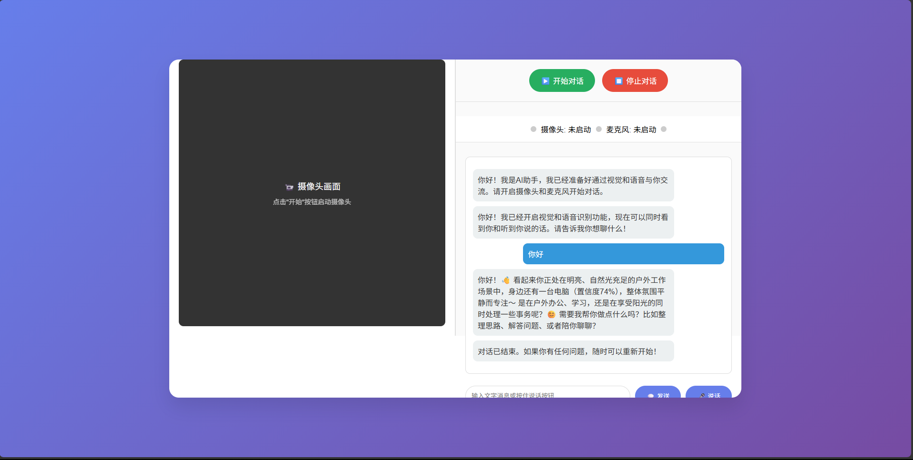

# VisoTalk

一个基于 Node.js 和通义千问（Qwen）大模型的 AI 视觉语音交互系统，支持实时摄像头画面分析、自然语言对话和多模态交互。
## 🎬 演示 Demo

**在线演示**：[(https://www.bilibili.com/video/BV1y1JW6tEUD/)]]

**本地演示截图**：

##  项目简介

本项目是一个端到端的 AI 视觉语音对话助手，能够：
- 🎥 实时调用摄像头捕捉画面
- 🔍 对视频帧进行智能视觉分析
- 💬 与用户进行自然流畅的中文对话
-  支持文字输入和语音录制
- 🖼️ 结合视觉内容提供上下文感知的智能回应

## ️ 技术栈

### 后端技术
- **Node.js** (LTS 版本) - 运行时环境
- **Express.js** (^4.18.2) - Web 服务框架
- **Axios** (^1.6.2) - HTTP 客户端，用于 API 调用
- **Multer** (^1.4.5-lts.1) - 文件上传处理
- **Sharp** (^0.33.1) - 图像处理库
- **UUID** (^9.0.1) - 唯一标识符生成
- **Dotenv** (^16.3.1) - 环境变量管理
- **CORS** (^2.8.5) - 跨域资源共享支持

### 前端技术
- **原生 HTML5/CSS3/JavaScript (ES6+)** - 无框架依赖
- **WebRTC API** - 摄像头和麦克风访问
- **Fetch API** - HTTP 请求
- **Canvas API** - 视频帧捕获
- Web Speech API (SpeechRecognition) - 浏览器端语音识别（Chrome / Edge）

### AI 服务
- **阿里云 DashScope (通义千问)** - Qwen-VL-Max / Qwen-Plus 多模态大模型

##  安装与配置

### 前置要求
- Node.js 18.x 或更高版本
- npm 9.x 或更高版本
- Python 3.7+ (可选，用于快速启动前端服务器)
- 现代浏览器（Chrome、Firefox、Edge 等，支持 WebRTC）

### 1. 克隆项目
```bash
git clone https://github.com/YUKIQVQ/VisoTalk.git
```
### 2. 安装依赖
```bash
install npm
```
这将安装以下核心依赖包：
- express: ^4.18.2
- cors: ^2.8.5
- dotenv: ^16.3.1
- multer: ^1.4.5-lts.1
- axios: ^1.6.2
- sharp: ^0.33.1
- uuid: ^9.0.1

开发依赖：
- nodemon: ^3.0.2

### 3. 配置环境变量

#### 获取 API 密钥
1. 访问 [阿里云 DashScope 控制台](https://dashscope.console.aliyun.com/apiKey)
2. 注册/登录账号
3. 创建新的 API 密钥
4. 复制完整的密钥字符串

#### 设置系统环境变量

**Windows (PowerShell):**
```powershell
$env:DASHSCOPE_API_KEY="sk-your-actual-api-key"
```
**Windows (CMD - 永久设置):**
```cmd
setx DASHSCOPE_API_KEY "sk-your-actual-api-key"
```
⚠️ 注意：使用 `setx` 后需要重新打开终端才能生效
### 4. 验证配置
Windows
```bash
echo %DASHSCOPE_API_KEY%
```
应该显示你的 API 密钥（至少前几个字符）。

## 🚀 启动服务

### 方法一：分别启动（推荐，便于调试）

#### 终端 1 - 启动后端服务
```bash
npm start
```
你应该看到：
✅ Qwen服务已初始化，使用模型: qwen-plus 
API地址: https://dashscope.aliyuncs.com/compatible-mode/v1 
🚀 AI视觉语音对话助手后端服务已启动 
📍 服务地址: http://localhost:3000
#### 终端 2 - 启动前端服务器

**使用 Python:**
```bash
python -m http.server 8080
```
**或使用 Node.js:**
```bash
npx http-server -p 8080
```
然后在浏览器访问：`http://localhost:8080/front.html`

## 🧪 测试 API
```bash
npm test
```
这将运行以下测试：
1. ✅ 健康检查 - 验证后端服务是否正常运行
2. ✅ AI 对话接口 - 测试与通义千问的集成
3. ✅ 视觉分析接口 - 测试图像分析功能

##  界面说明

### 布局结构
- **左侧面板**：实时摄像头画面显示
- **右侧面板**：
  - 控制按钮（开始/停止对话）
  - 状态指示器（摄像头、麦克风）
  - 视觉分析结果展示
  - 聊天历史记录
  - 消息输入框

### 功能特性
- ✅ 实时摄像头访问（WebRTC）
- ✅ 视频帧自动捕获与分析
- ✅ 文字消息发送
- ✅ 语音录制模拟
- ✅ 视觉分析结果可视化
- ✅ 错误提示与状态反馈

## 🎤 语音交互说明

- 点击「🎤 说话」按钮开始识别，使用浏览器原生 Web Speech API（SpeechRecognition），识别语言为 zh-CN，无需额外后端服务或密钥。
- 识别完成后文本自动填入输入框，并在约 0.5 秒后作为消息发送，结合当前摄像头画面进行多模态对话。
- 需要 Chrome 或 Edge 浏览器并授予麦克风权限；不支持的浏览器会给出明确提示，仍可使用文字输入。
- 针对未检测到语音、权限被拒等识别错误有相应提示，并自动恢复按钮状态。

## 📝 原创性声明

### 第三方库与框架

本项目使用了以下开源库和框架：

| 库名称 | 版本 | 用途 | 许可证 |
|--------|------|------|--------|
| Express | ^4.18.2 | Web 服务框架 | MIT |
| Axios | ^1.6.2 | HTTP 客户端 | MIT |
| Multer | ^1.4.5-lts.1 | 文件上传处理 | MIT |
| Sharp | ^0.33.1 | 图像处理 | Apache-2.0 |
| UUID | ^9.0.1 | 唯一 ID 生成 | MIT |
| Dotenv | ^16.3.1 | 环境变量加载 | BSD-2-Clause |
| CORS | ^2.8.5 | 跨域支持 | MIT |
| Nodemon | ^3.0.2 | 开发热重载 | MIT |

### 原创部分

以下内容为本项目原创开发：

1. **前端界面与交互逻辑** (`front.html`)
   - 响应式左右分栏布局设计
   - WebRTC 摄像头集成
   - Canvas 视频帧捕获
   - 聊天界面与消息管理
   - 状态指示器与错误处理

2. **后端服务架构** (`server.js`, `start-backend.js`)
   - RESTful API 设计
   - 路由规划与中间件配置
   - 文件上传处理
   - 错误处理机制

3. **AI 服务集成** (`services/qwenService.js`)
   - 通义千问 API 封装
   - 消息上下文管理
   - Token 估算与成本计算
   - 错误处理与重试机制

4. **视觉分析服务** (`services/visionService.js`)
   - 图像预处理优化
   - 本地特征提取
   - 缓存策略实现

5. **工具模块** (`utils/cache.js`)
   - TTL 缓存管理
   - 自动清理机制

6. **测试与配置脚本** (`test-api.js`, `setup-env.js`)
   - API 自动化测试
   - 环境配置向导
## 📊 性能优化

### 成本控制策略
1. **本地预处理**：使用 Sharp 进行图像压缩，减少 API 调用数据量
2. **智能缓存**：视觉分析结果缓存 5 分钟，避免重复分析
3. **按需调用**：仅在必要时调用 AI API，本地处理简单任务

### 建议优化方向
- 实现 WebSocket 长连接，减少 HTTP 开销
- 添加请求限流，防止超额调用
- 使用 CDN 加速静态资源
- 实现增量更新，只传输变化的数据

## 📄 许可证

本项目仅供学习和研究使用。使用本项目的第三方库需遵循其各自的开源许可证。

## 🔗 相关链接

- [阿里云 DashScope 官方文档](https://help.aliyun.com/zh/model-studio/)
- [通义千问 API 参考](https://dashscope.console.aliyun.com/apiKey)
- [Express.js 官方文档](https://expressjs.com/)
- [WebRTC API 文档](https://developer.mozilla.org/en-US/docs/Web/API/WebRTC_API)


## 👨‍💻 作者

本项目由开发者独立创建和维护。

##  致谢

感谢以下开源项目和社区：
- Express.js 团队
- 阿里云 DashScope 团队
- 所有贡献者


